# Sandover

Project Sandover is built on OpenGOAL; the upstream project's README is kept as
[README.opengoal.md](README.opengoal.md).

A lighting and materials remaster of *Jak and Daxter: The Precursor Legacy*, built on
[OpenGOAL](https://github.com/open-goal/jak-project). Sandover keeps the game, its levels and its
art direction, and changes how the world is lit and shaded:

- shadows from the sun, the moon and local lights (lamps, crystals, eco) on actors and the world
- ground-truth ambient occlusion (GTAO), and light cast by glowing surfaces: eco, lava, lamps,
  crystals (the red crystals of the Mountain Pass and the blue wall crystals of the Spider Cave light their surroundings)
- PBR materials (normal and roughness per texture), fur, ice, metals that take the level's light
- reworked water: clear inland water, wet shorelines with foam, sun glint shadowed by the world
- neighbouring levels drawn for real in the distance, with fog at least as dense as the original
- a sun, moon and stars in the style of *Jak 3*
- HDR10 or scRGB output with an in-game calibration page
- temporal antialiasing (the default) and render scale with AMD FidelityFX FSR 3.1, FSR 4 (on
  supported AMD cards) or NVIDIA DLSS
- VR through OpenXR on SteamVR (tested on a PSVR2), with the upscaler run per eye and the menus
  and HUD on a flat panel in front of you
- surround and spatial audio: 5.1, 7.1, headphones, and Dolby Atmos, Windows Sonic or DTS:X
  through Windows Spatial Sound, with a speaker test

**Status: public beta, 0.9.0.** A partial playthrough found no crashes or
progression blockers; see [Known issues](#known-issues).

## Screenshots

Sentinel Beach from above Sandover Village at sunset: the low sun lays a bright path across the
water, and the palms and cliffs catch it on their edges.

| Stock OpenGOAL | Sandover |
|---|---|
| 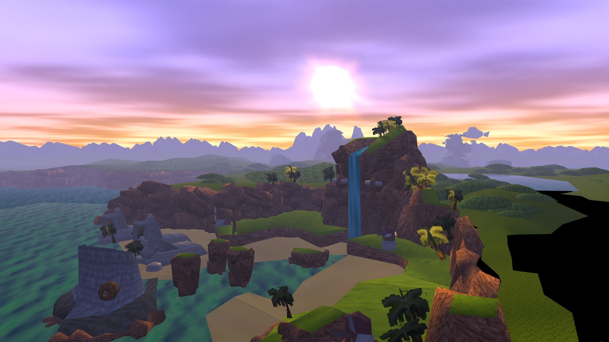 | 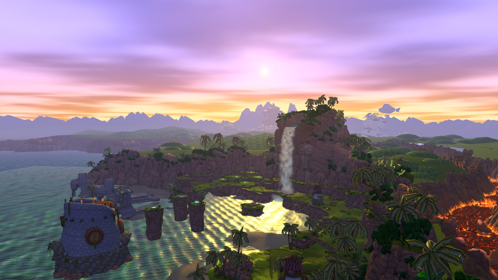 |

Forbidden Jungle coast at dawn: the sun rises over the open sea and a path of sunlight runs
across the waves.

| Stock OpenGOAL | Sandover |
|---|---|
| 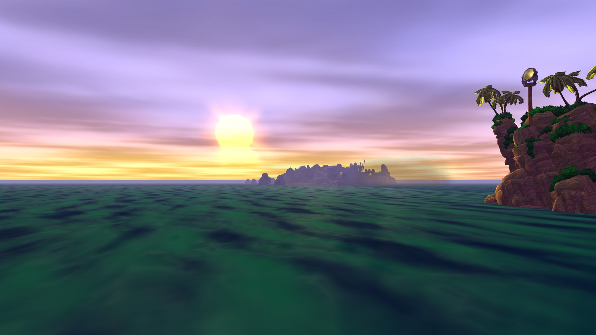 | 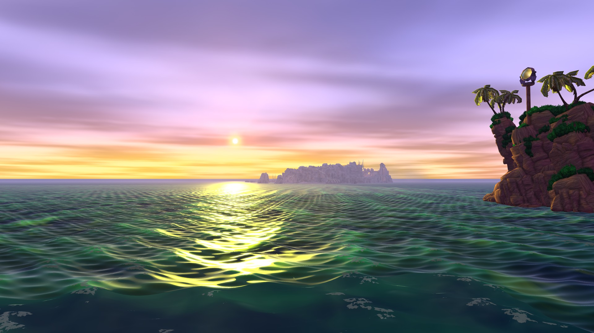 |

Snowy Mountain at sunrise: low, grazing light across the snow, with glints sparkling on the
drift in front.

| Stock OpenGOAL | Sandover |
|---|---|
| 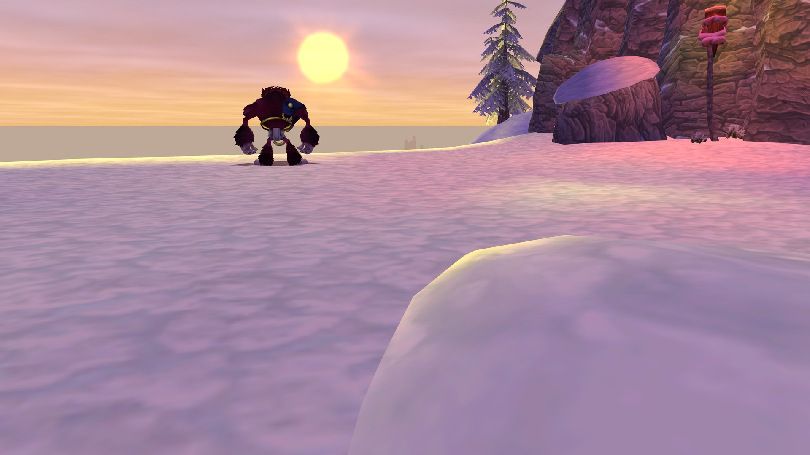 | 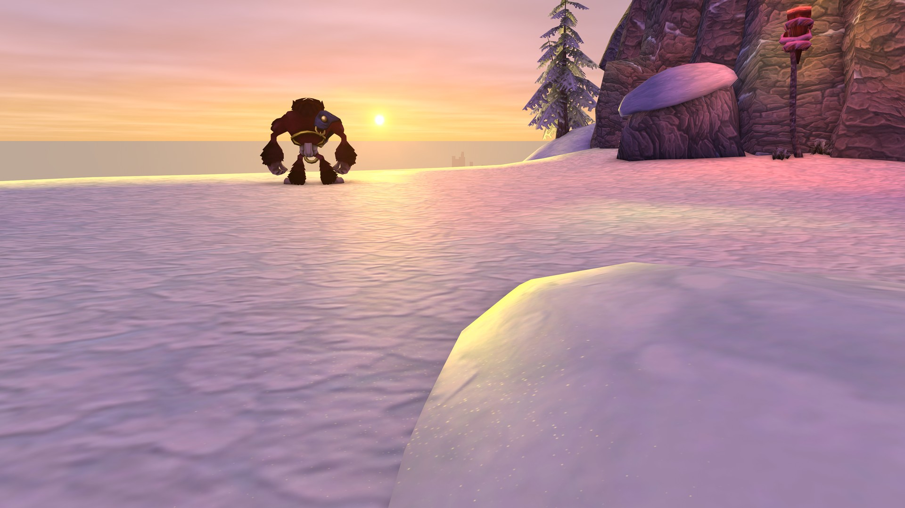 |

Lava Tube: the lava field lights the rock around it in orange.

| Stock OpenGOAL | Sandover |
|---|---|
| 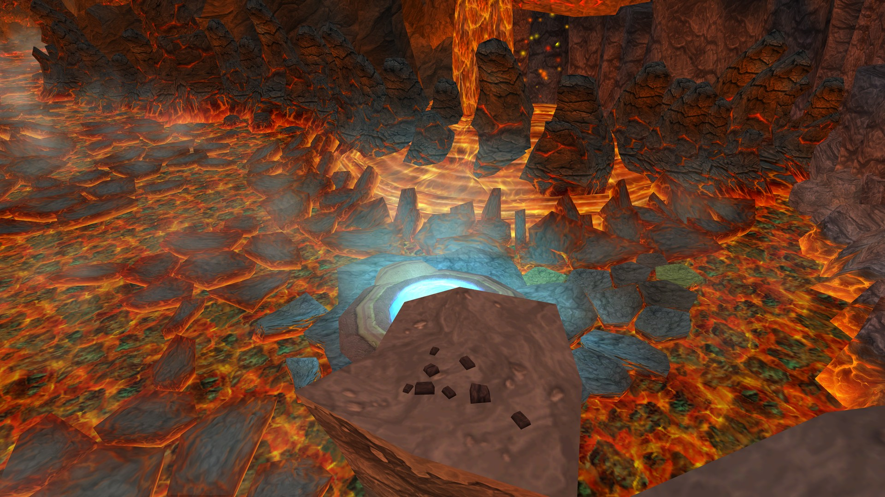 | 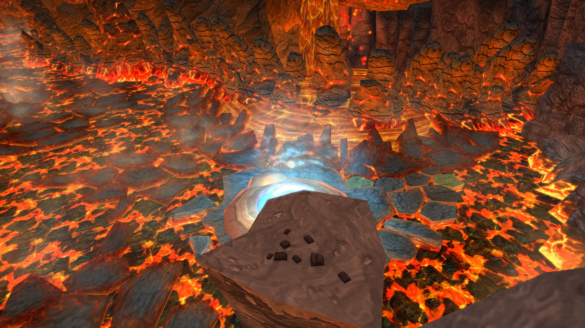 |

Spider Cave: the blue and green crystals light the cave wall and floor around them.

| Stock OpenGOAL | Sandover |
|---|---|
| 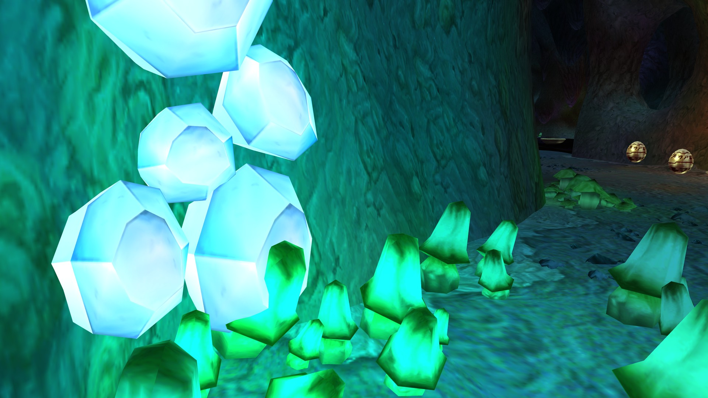 | 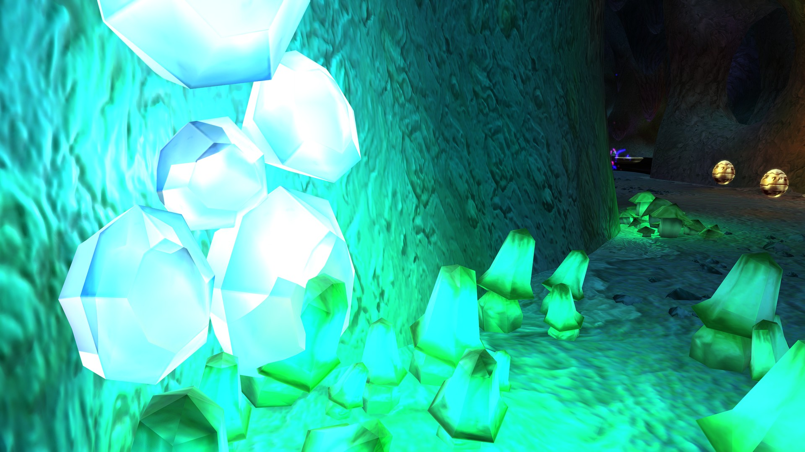 |

Sentinel Beach at dawn: low morning sun lights the cliffs and the waterfall in the cove.

| Stock OpenGOAL | Sandover |
|---|---|
| 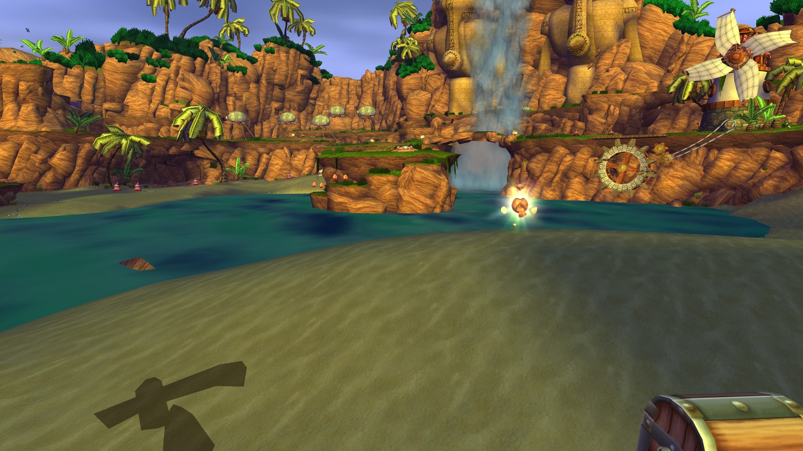 | 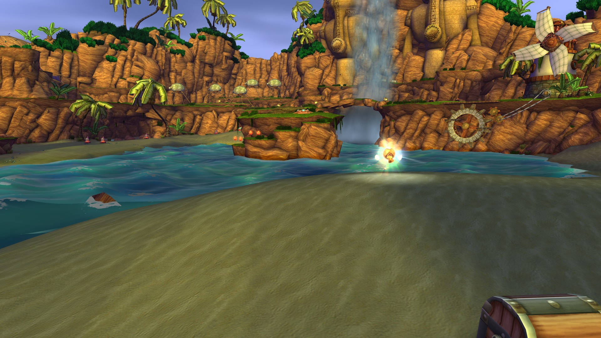 |

## Requirements

- **Windows** 11, 64-bit, with a current graphics driver. Development and testing used AMD
  Radeon and NVIDIA GPUs on Windows 11. Nothing is vendor-only: any GPU with OpenGL 4.3 and a CPU
  with AVX runs every effect and FSR 3.1. Windows 10 should work but is untested.
- **Optional, per feature:** DLSS needs an NVIDIA RTX card and `nvngx_dlss.dll` (not included, see
  [Settings](#settings)); FSR 4 needs a card and driver that support it (Radeon RX 9000 series,
  or RX 7000 with a recent driver) and DirectX 12; HDR needs an HDR display with Windows HDR on
  and a driver with OpenGL-Direct3D interop (`WGL_NV_DX_interop2`); VR needs an OpenXR runtime (SteamVR) and a headset.
- **The [OpenGOAL launcher](https://opengoal.dev)**, a recent version with mod support.
- **Your own copy of the game** as a disc image (`.iso`) made from your own disc. Nothing from
  the game is in this repository; what the download holds is listed under [Install](#install).
  If you already play Jak 1 in the launcher, the mod reuses the disc data you gave it.

### Disc version

Sandover's lighting data is built for the **original North American release (NTSC-U 1.0)**.

- NTSC-U 1.0: everything works as intended.
- Other releases (PAL, NTSC-J, later NTSC-U printings) should work, untested; only NTSC-U 1.0
  was tested. Where a level's geometry differs from NTSC-U 1.0, the differing parts keep the
  original lighting, and the game log names the level (`unbake: <level> ...`).

## Install

The OpenGOAL launcher is the only supported way to install Sandover.

1. In the launcher, open **Settings > Mods**, paste this into **Mod Source URL** and press **Add**:

   ```
   https://raw.githubusercontent.com/bouzou4/project-sandover/master/sandover/release/mod-source.json
   ```

2. Open **Jak and Daxter**, then **Features > Mods**. Pick **Sandover (beta)** under
   **Available Mods** and install it. The launcher downloads the release, builds the game from
   your disc data (a few minutes) and gives the mod its own **Play** button.
3. Optional, for VR: see [VR](#vr). The launcher's **Play** button starts the flat-screen game.
4. Optional, for HDR: turn on **Use HDR** for your display in Windows Settings > System > Display
   before starting the game, then set peak brightness, paper white and black level on
   **Options > Sandover > HDR CALIBRATION**.

Updates arrive through the same mod source. Sandover keeps its own settings and saves, separate
from the stock game in the launcher.

The download (about 400 MB) holds the engine, the game's source code, and data Sandover derived
offline from the game's files: per-texture PBR maps, canopy maps and per-level lighting sidecars
for NTSC-U 1.0. Your own Jak 1 disc image is still required.

## Settings

Everything but contact shadows is on by default. **Pause > Options > Sandover** has:

- **VANILLA RENDERING**, off by default: the stock OpenGOAL renderer (MSAA at the stock setting,
  no Sandover effects). Every other row greys out while it is on.
- an **on/off row for each enhancement**: AMBIENT OCCLUSION, EMISSIVE LIGHT, BLOOM,
  ACTOR SHADOWS, MATERIALS, FUR, WATER, SUN GLINT ON WATER, NEIGHBOUR LEVELS, SUN,
  FP16 COLOR, and CONTACT SHADOWS (off by default)
- **LOW / MEDIUM / HIGH** only for the two heavy ones: SHADOW QUALITY (HIGH by default) and
  AMBIENT OCCLUSION QUALITY, which adds ULTRA (MEDIUM by default)
- **MOTION BLUR** (OFF, WEAK, MEDIUM, STRONG; MEDIUM by default) blurs moving actors only, and
  **CAMERA MOTION BLUR** (OFF, VEHICLES, ALWAYS; VEHICLES by default) adds the camera's own motion
- **HDR OUTPUT**: PQ (HDR10, the default), SCRGB, or off, and the **HDR CALIBRATION** page. The
  game presents HDR only while Windows HDR is on for its display; otherwise it runs in SDR.
- **UPSCALER**: TEMPORAL AA (FSR 3.1), the antialiasing of every Sandover frame (AMD FidelityFX
  FSR 3.1, vendor-neutral, any GPU with OpenGL 4.3). **FSR 4** is offered where the card and
  driver support it; AMD's runtime for it ships with the mod. On NVIDIA graphics cards **DLSS**
  is offered as well. It needs `nvngx_dlss.dll`,
  which is not included: a copy placed in the mod folder next to `gk.exe` is used first (it is
  usually taken from the [DLSS SDK](https://github.com/NVIDIA/DLSS) or from an installed game that
  uses DLSS); otherwise a copy the NVIDIA App has stored on the system is used when there is one.
  Without either the DLSS entry is not offered.
- **RENDER SCALE** (100%, 77%, 67%, 59%, 50%, 33%), each with the resolution it renders at and the
  quality name (NATIVE, or DLAA with DLSS, QUALITY, BALANCED, PERFORMANCE, ULTRA PERFORMANCE); 100%
  by default
- **AUDIO** page: OUTPUT (AUTO, STEREO, 5.1, 7.1, HEADPHONES, SPATIAL), DEVICE, and a SPEAKER
  TEST that plays a burst on each channel in turn (see [Audio](#audio))

Some rows depend on others: EMISSIVE LIGHT needs AMBIENT OCCLUSION on, CONTACT SHADOWS need
ACTOR SHADOWS on and temporal AA, CAMERA MOTION BLUR needs MOTION BLUR on, and HDR OUTPUT
and HDR CALIBRATION need FP16 COLOR on. A greyed-out row is waiting for the row it depends on.

On a weaker GPU, render resolution is the safe lever: the game's art was made for PS2
resolution, so rendering below your display's resolution costs far less than it would in a
modern game. Turn individual enhancements off after that.

If exclusive fullscreen looks washed out in HDR, close overlays such as the NVIDIA app overlay
and try again.

## VR

Sandover plays in a headset through OpenXR; it was developed on a PSVR2 with SteamVR. Start
SteamVR, then start `gk.exe` in the mod folder with `--xr` plus the launcher's boot arguments;
the launcher's **Play** button starts the flat-screen game. Press **F6** while sitting the way you will play to
recentre.

- While a headset session runs the options page edits a separate VR profile (VR SETTINGS), saved
  apart from the flat-screen settings. Render scale defaults to 67% of each eye's frame.
- The upscaler runs per eye (FSR 3.1 or FSR 4; DLSS, contact shadows, HDR output and motion blur
  are not available in VR).
- Menus, HUD, text and subtitles are on a flat panel 2 m in front of you. The blackout and
  letterbox cover that panel, not the whole view.
- Head motion is smooth at the headset's rate; the game's own animation runs at 60 Hz.

## Audio

**Pause > Options > Sandover > AUDIO** sets the output: AUTO follows the speaker layout Windows
reports for the device, and STEREO, 5.1, 7.1 and HEADPHONES (binaural) force one. SPATIAL uses
Windows Spatial Sound (Dolby Atmos, Windows Sonic or DTS:X, whichever Windows has enabled for the
device) and applies at the next game start. In surround, dialogue goes to the centre, music and
ambience are spread to the sides and rear, and positional effects are placed around you. The
SPEAKER TEST helps check the wiring; the page names the device, the output in use and any
mismatch with the Windows speaker setup.

## Known issues

- **Effects take a long time to appear the first time they are used.** The graphics driver
  builds each effect's pipelines on its first draw and a level's material maps upload when it
  first comes into view, so the first seconds after boot, after a load, and after turning an
  effect on can stall, or show black in VR. The game is not held back while this happens.
- **Distant geometry of a neighbouring level overlaps the real level geometry** in some far
  views, seen in the precursor basin and in a lava area. Visual only.
- **Input can stop responding after changing a graphics setting in an in-game menu** while the
  game keeps running. It recovers after a wait.
- **VR:** actors can be missing at the far edge of the view when the head is turned quickly;
  heat haze does not follow the head; the blackout and letterbox cover only the menu panel.
  Only the PSVR2 through SteamVR has been tested.
- **Audio:** surround routing is proven by measurement, not yet by listening on a receiver, and
  Dolby Atmos and DTS:X on a receiver are untested. Cutscene dialogue routing is unverified.
- **Jak can render as a white silhouette** during the zoomer overheat death with HDR on.
- **A thin lit sliver** shows along one contact crease in the jungle (shadow bias).

## Roadmap to 1.0

- Gate the game on a ready state: hold the loading screen until every enabled effect is built,
  instead of stalling in play
- VR: pass a full smoke test on real headsets
- Performance-tiered settings for lower-end GPUs
- Further optimization
- Linux and Steam Deck

## Reporting bugs

Use the in-game bug report, so the problem can be reproduced:

1. Where you see the problem, press **F7** (or **Options > Sandover > SAVE BUG REPORT (F7)**).
   "BUG REPORT SAVED" shows at the top left.
2. The report goes to the `bug-reports` folder in the mod's settings folder, inside the
   launcher's install folder: `features/jak1/mods/Sandover/_settings/sandover/bug-reports`. Each
   report is a PNG of the frame, a JSON sidecar (level, camera, time of day, your Sandover
   settings, display and HDR state, build, Windows version, GPU and driver, the end of the game
   log) and a zip of both. File paths and your user name are removed before it is written.
3. Open an issue with the **Sandover bug report** form, say what you saw and what you expected,
   and attach the zip.

## Building from source

Sandover is a fork of OpenGOAL's [jak-project](https://github.com/open-goal/jak-project), and
the upstream build instructions apply. Sandover's own notes are in `sandover/kb/` (start with
`sandover/kb/howto/build-and-extract.md`); release packaging is described in
`sandover/kb/findings/2026-10-08-packaging.md`.

## License and credits

- Built on [OpenGOAL](https://opengoal.dev) by the OpenGOAL team, whose decompilation, compiler
  and PC port make this possible. Sandover is not affiliated with or supported by the OpenGOAL
  team; report Sandover problems here, not to them.
- *Jak and Daxter* is a Naughty Dog game published by Sony Interactive Entertainment. Sandover is
  an unofficial fan project; you need your own copy of the game.
- Source code: ISC License, as upstream (`LICENSE`). Third-party libraries keep their own
  licenses under `third-party/`; OpenAL Soft (LGPL) ships as a separate DLL with its notices,
  and its source is in `third-party/openal-soft` at the release tag.
